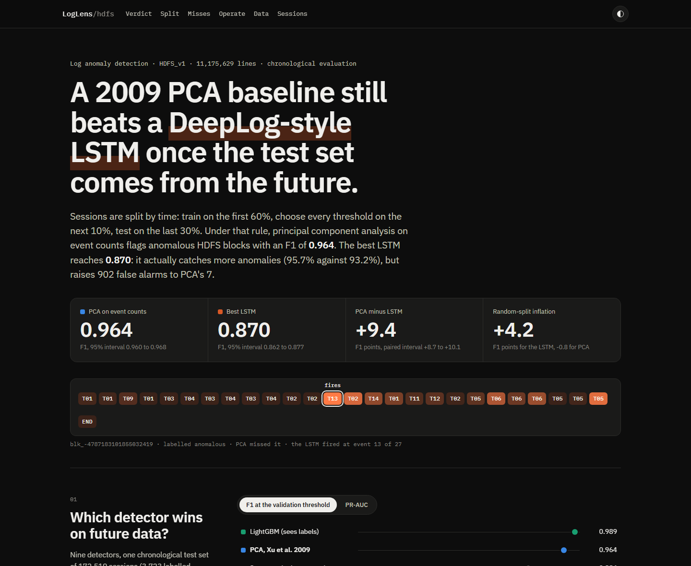
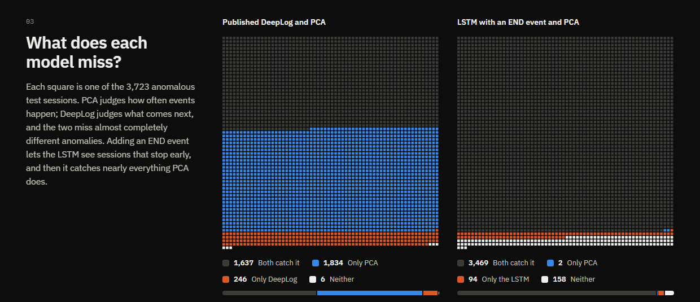

# LogLens: Do Sequence Models Really Catch Anomalous Logs?

Published log anomaly detectors report near-perfect scores on the HDFS benchmark, but most of those numbers come from random train/test splits that let a model see the future. LogLens asks what is left once the evaluation is honest about time. It takes the 11.2 million raw lines of the LogHub HDFS_v1 log, parses them in PySpark into bronze, silver and gold Parquet layers, groups them into 575,061 block-level sessions, and compares a DeepLog-style LSTM against PCA, Isolation Forest and a supervised LightGBM on a strict chronological split. It also measures how much a random split inflates each score, how many test sequences the model has already seen verbatim in training, and how many alerts per hour each model would raise. The method is then repeated on BGL (no natural sessions) and the pipeline is scaled to all 211 million Thunderbird lines.

Built with Python, PySpark (Parquet medallion layers), Drain3, scikit-learn, LightGBM, PyTorch and MLflow on the public LogHub datasets, run in Docker.

> **What it's for:** checking whether a log anomaly detector's headline score survives a time-ordered evaluation, and seeing, session by session, which event in a sequence made the model raise an alert.

**Live demo:** [halcyonvector.github.io/LogLens](https://halcyonvector.github.io/LogLens/) (a single static page; every number on it comes from the pipeline's exported aggregates)





**Status:** the HDFS study, the BGL generalization run and the Thunderbird scale benchmark are complete and on the dashboard.

---

## Disclaimer

This is a personal research and learning project on public benchmark data. It is **not a production intrusion or anomaly detection system** and makes no claims to that effect. The HDFS logs are from 2008 and their labels come from the dataset's original authors; any result here describes this benchmark, not how a model would behave on your systems.

---

## Findings

Real results from the full pipeline; every number below is exported by it and shown on the dashboard.

### The data

- **Every line parses, and the totals reconcile exactly.** One regex splits all **11,175,629** raw lines into date, time, pid, level, component and message, with **0** sent to quarantine. Raw = bronze + quarantine holds to the line, and the log spans **38.69 hours** (9 Nov 2008 20:35 to 11 Nov 2008 11:16), matching LogHub's published 38.7.
- **One line in eight names its block twice, and a naive count would double them.** **1,402,056** lines (12.5%) contain two block IDs, but always the same block (as in "Deleting block blk_X file .../blk_X"). Exploding every match would invent 1.4M duplicate events; de-duplicating IDs within each line gives exactly one block per line, so the 11,175,629 lines become exactly 11,175,629 session events. (An earlier version of this README read these as lines spanning two sessions; the gold-layer checks caught it.)
- **The levels say almost nothing on their own.** There are **no ERROR lines at all**: 96.8% INFO and 3.2% WARN (362,793 lines), and **98.2%** of those WARN lines come from a single component, `dfs.DataNode$DataXceiver`. Four components produce 98.8% of all lines.
- **Accuracy would be meaningless here.** Of 575,061 block sessions, **16,838** are labelled anomalous (2.93%), so a model that calls everything normal scores 97.07% accuracy. LogLens reports precision, recall, F1 and PR-AUC instead.

### The chronological split

- **Time is very uneven across the split.** Ordering sessions by their first event, the first 60% (train, **345,036** sessions) start over **31.7 hours**, while the last 30% (test, **172,519**) start within the final **5.1 hours**. Line volume swings 34x from hour to hour, so the split is made by session order, not clock time.
- **The test period has a third fewer anomalies.** The anomaly rate is **3.23%** in train, **3.40%** in validation and **2.16%** in test. Any threshold tuned on earlier data meets a different base rate later, which a random split would hide.
- **The most common warning disappears after training.** All **356,207** "Got exception while serving" lines (the bulk of the WARN lines) occur before the training cutoff; none appear in validation or test. A model that leans on warning volume would see a shift that a random split hides.

### Parsing (silver layer)

- **Masking collapses the training period to 51 distinct messages.** After block IDs, IPs, paths and numbers are masked in Spark, the **6,856,030** training-period lines reduce to **51** distinct messages, so Drain3 learns its templates from every training line in about 25 seconds instead of looping over millions of rows in Python.
- **Drain3's default threshold hides an anomaly signal.** At the default similarity threshold (0.4), Drain3 merged "PacketResponder N for block X **terminating**" (1.7M lines, normal) with "... **Interrupted**" (49 lines, a failure) into one template. That single merge cut grouping accuracy against LogHub's ground truth to **84.6%**. Sweeping the threshold and choosing on the validation period gives **0.9**: **50 templates, zero merges, 99.84% grouping accuracy** (99.80% on validation, 99.78% on test). The only remaining differences are harmless splits, such as one template per exception text where LogHub uses one for all.
- **Template drift is tiny but real.** Only **15** lines in validation and test match no learned template (4 and 11). Ten of them are "Adding an already existing block", an event that never occurs in the training period. These get an `UNK` event rather than being forced into the nearest template.
- **Spark-native matching is fastest, and all three methods agree on every line.** Tagging all 11.2M lines took **34.0 s** with templates compiled to regexes in Spark SQL (about 329,000 lines per second), **49.7 s** with Drain3 inside a pandas UDF and **64.7 s** with a distinct-message lookup join, and all three produced the same event for all 11,175,629 lines.
- **The session logic reproduces LogHub's published traces exactly.** Tagging each line with LogHub's 29 ground-truth templates and grouping by block reproduces the published event sequence, in order, for **all 575,061 blocks**. This validates the block explode and the (timestamp, line) ordering before any model is trained on them.

### Sessions and baselines

- **575,061 sessions, but only 18,375 distinct event sequences and 597 distinct count vectors.** The median session has 19 events and the longest 298. HDFS block behaviour is extremely repetitive.
- **Labels are almost a function of the sequence.** Only **10** sequences occur with both labels (46 sessions), so a model that sees the whole sequence has almost no irreducible error.
- **A time-ordered split does not remove duplication here.** **99.0%** of chronological test sessions have an event sequence already seen in training, against **97.7%** under a random split (for anomalous test sessions, 80.6% against 78.9%). On HDFS the repetition comes from the system itself, not from shuffling.

Chronological test set (172,519 sessions, 3,723 anomalous). Each threshold is chosen on the validation period. LSTM rows are the mean of 3 seeds (with the standard deviation of F1); the other rows are single runs, and bootstrap confidence intervals are not yet computed.

| Model | Precision | Recall | F1 | PR-AUC | False-positive rate | F1 on never-seen sequences |
|-------|-----------|--------|----|--------|---------------------|----------------------------|
| WARN rule (any warning line) | 1.000 | 0.446 | 0.617 | 0.458 | 0.000% | 0.690 |
| Sequence lookup + novelty | 0.792 | 1.000 | 0.884 | 0.792 | 0.578% | 0.598 |
| **PCA, Xu et al. (5 components)** | **0.998** | **0.932** | **0.964** | **0.930** | **0.004%** | **0.844** |
| Isolation Forest | 0.806 | 0.568 | 0.666 | 0.751 | 0.302% | 0.678 |
| DeepLog LSTM, top-g | 0.758 | 0.510 | 0.610 ± 0.006 | 0.548 | 0.360% | 0.758 |
| DeepLog LSTM + END event, top-g | 0.759 | 0.668 | 0.710 ± 0.043 | 0.649 | 0.473% | 0.740 |
| DeepLog LSTM + END event, log-probability score | 0.779 | 0.980 | 0.867 ± 0.015 | 0.930 | 0.619% | 0.702 |
| DeepLog LSTM + END event, tuned (128 units), log-probability score | 0.801 | 0.966 | 0.873 ± 0.030 | 0.925 | 0.548% | 0.692 |
| LightGBM (supervised reference) | 0.979 | 0.998 | 0.989 | 0.9999 | 0.047% | 0.944 |

- **A random split barely changes the count-based models.** The two test sets have different anomaly rates (2.94% under the random split, 2.16% under the chronological one), and precision rises with the anomaly rate even for an identical detector. After rescaling the random-split result to the chronological rate, F1 moves by **-0.9** points for PCA, **+0.8** for LightGBM and **+0.6** for Isolation Forest. With duplication this high under both splits, there is little extra for a random split to leak.
- **The largest gap runs the other way, and it is distribution shift.** The WARN rule scores F1 **0.617** on the chronological test but **0.107** on a random one. The 356,207 "Got exception while serving" warnings, mostly in normal sessions, only occur early in the log: a random test set inherits them as 38,064 false alarms, while the chronological test period never sees them.
- **Novelty is the strongest single signal.** **1,699** chronological test sessions have a sequence never seen in training; **42.6%** of them are anomalous (against 2.2% overall), and they hold **19.4%** of all test anomalies. Looking up the training label of seen sequences and flagging every unseen one already reaches F1 **0.884**, beating Isolation Forest and the WARN rule.
- **The honest comparison is on never-seen sequences.** On those 1,699 sessions F1 falls from 0.964 to **0.844** for PCA and from 0.989 to **0.944** for LightGBM. On repeated sequences the models are largely recognising what they were shown in training.

### The sequence model (DeepLog-style LSTM)

- **Under a time-ordered split, the LSTM does not beat PCA.** DeepLog as published (10-event history, a session flagged when any event falls outside the model's top g predictions, g chosen on validation) reaches F1 **0.610 ± 0.006** over 3 seeds against PCA's **0.964**. The best variant (an END event plus a continuous log-probability score) reaches **0.867 ± 0.015**, and **0.873 ± 0.030** after tuning. It matches PCA's PR-AUC (**0.930**) but raises about 150 times as many false alarms at its validation-chosen threshold (0.62% of normal sessions against 0.004%).
- **One anomaly in five simply stops early.** **683** of the 3,723 test anomalies are exact prefixes of normal training sessions: every event in them is a perfectly normal next event, so plain DeepLog catches **2** of them. Adding an END event after each session's last event lets the model flag a session that stops where it shouldn't, which lifts recall from 0.51 to **0.67** at top-g and to **0.98** with the log-probability score.
- **A better language model caught fewer anomalies.** A first version that trained on noisy batches scored higher by luck. Once training was fixed and the model predicted normal behaviour better (validation loss 0.27 down to 0.19), recall fell to 0.51, because the anomalies it missed were never unusual next events in the first place.
- **Published DeepLog and PCA miss almost completely different anomalies.** PCA catches **1,834 of the 1,840** anomalies plain DeepLog misses, and DeepLog catches **246 of the 252** anomalies PCA misses. Next-event models see order; count models see how often things happen. With the END event the picture changes: the tuned LSTM catches **95.7%** of test anomalies against PCA's 93.2% (only 2 that PCA catches slip past it), and loses on F1 only through its **902** false alarms against PCA's **7**.
- **Top-g throws information away.** With the END event, scoring each session by its least likely event instead of its worst rank raises F1 from 0.710 to 0.867 and steadies it across seeds. The chosen g also swings between 5 and 8 from one seed to the next.
- **Tuning the LSTM barely moves it.** A search over history length (5, 10, 20 events) and hidden size (64, 128 units), scored only on the validation period, picked 10 events and 128 units (validation PR-AUC 0.936 against 0.926 for the published setting). On test it steadies the top-g score (F1 0.744 ± 0.005 against 0.710 ± 0.043) but leaves the best score where it was: F1 **0.873** against 0.867, and PR-AUC 0.925 against 0.930. The gap to PCA is not a tuning problem.
- **The sequence model leaks under a random split; the count models barely do.** After correcting for the random test set's higher anomaly rate, a random split adds **3.4** points of F1 for plain DeepLog, **4.1** for the END variant's log-probability score and **8.0** for its top-g score, against under 1 point for PCA and LightGBM. The clearest sign is on never-seen sequences: the END variant's F1 there is **0.84** under a random split but **0.70** under the chronological one, so new sequences from the same hours are far easier to judge than new sequences from later on.
- **Even training length gives the random split away.** With early stopping on validation loss, chronological runs stop after 16 to 27 epochs, while random-split runs keep improving for 42 to 56. A shuffled validation set looks like the training data, so the model keeps finding more of it to learn.

### Uncertainty, operations and the end of the log

Intervals are 95% bootstrap intervals over 1,000 resamples of the chronological test sessions (LSTM rows use seed 0, whose per-event scores are saved).

- **The PCA lead is real at the alert threshold, not in ranking.** PCA's F1 is **0.964 [0.960, 0.968]** against **0.870 [0.862, 0.877]** for the tuned LSTM; the paired difference is **+9.4 points [+8.7, +10.1]**, positive in every resample. Their PR-AUC is statistically tied (+0.3 points [-0.7, +1.2]): the LSTM ranks sessions about as well, and loses where the threshold has to separate them.
- **Almost every PCA alert is real.** Over the 5.1 test hours PCA raises **688 alerts an hour**, of which **1.4** are false (0.04 per 1,000 normal sessions). The tuned LSTM raises 883 an hour, **178** of them false.
- **A live count model would wait half a day.** A live system cannot know a session has finished; it has to assume so after a stretch of silence. Normal HDFS blocks routinely go quiet for hours before they are deleted, so that stretch has to be **12.3 hours** (the 99th percentile of the longest pause inside normal training sessions). PCA, and any detector that judges a finished session, therefore alerts a median **12.5 hours** after an anomalous session's first event. Published DeepLog fires on the surprising event itself: a median **6 seconds** in, with **72%** of its catches inside a minute.
- **The time-ordered test set is also the end of the log.** The test period is the last 5 hours of a 38.7-hour log, and deletions come hours after a block is written, so only **59.6%** of test sessions reach their "Deleting block" events against **92.3%** of training sessions. The read traffic of the early hours has also gone: "Served block" appears in **39.8%** of training sessions and **0%** of test sessions. Every model is judged on these cut-off sessions, and a normal session that was merely cut off looks exactly like one that stopped early, which is a likely source of the END variant's false alarms.
- **Even PCA's few mistakes come from that shift.** All **7** of its false alarms contain "Served block", the read traffic that almost vanished from the test period. Both models' misses are replication sessions: the replication templates appear in every missed anomaly, against 17% of all anomalies.
- **PCA needs little data but is fragile with it.** Refitted on 1% of the training period (3,450 sessions, about what DeepLog trained on), PCA's F1 ranges from **0.724 to 0.964** across 5 random draws of those sessions (mean 0.871), and from 0.750 to 0.965 at 10%; LightGBM stays within 0.934 to 0.997, and the LSTM (one draw per size) scores 0.902 at 1% and 0.852 with everything.

### Generalization: the same method on BGL

BGL is 4,747,963 lines from a Blue Gene/L supercomputer over 215 days, with an alert tag on every line (348,460 alert lines, 7.3%). It has no natural sessions, so the log is cut into **1-hour windows** (3,605) or **20-line windows** (237,399), and a window is anomalous if any line in it carries an alert. Each scheme gets its own chronological split and its own parser, fitted only on its own training period, because 60% of the hours and 60% of the lines end months apart (11 October against 28 July).

| Time-ordered test F1 | 1-hour windows | 20-line windows | 20-line windows, parser fitted on the whole log |
|----------------------|----------------|-----------------|--------------------------------------------------|
| Any FATAL or FAILURE line (rule) | **0.854** | **0.622** | 0.622 |
| PCA | 0.326 | 0.167 | 0.409 |
| Isolation Forest | 0.596 | 0.139 | 0.139 |
| LightGBM (supervised) | 0.657 | 0.114 | 0.114 |
| DeepLog LSTM, log-prob (3 seeds) | 0.347 | 0.176 | 0.244 |

- **On later data, a one-line rule beats every model.** Flagging any window that contains a FATAL or FAILURE line scores F1 **0.854** on 1-hour windows and **0.622** on 20-line windows; no model gets close on either.
- **The failures change over time.** On the 20-line split, two kernel error types (KERNDTLB and KERNSTOR) are **93%** of the training period's alert lines and almost vanish afterwards (14 lines in the whole test period). The test period's anomalies are mostly application and other kernel failures, and **41.7%** of test-period alert lines belong to categories that never occur in training at all. A supervised model learns what failures used to look like; the FATAL rule survives because most alerts, whatever their kind, are logged at FATAL level.
- **So does the vocabulary.** A parser fitted on the 20-line scheme's training period cannot name **69%** of test-period lines (41% on the 1-hour scheme, whose training period ends later). In the test period, 69.7% of lines belong to ground-truth templates that never occur in training. The parser is accurate on what it has seen: grouping accuracy against Loghub-2.0's ground truth is **90%** on its training period, and almost every known line is grouped correctly later on; what collapses is coverage.
- **The LSTM flags almost everything.** An unknown event is always outside the LSTM's top predictions, so on honest 20-line windows it flags nearly every test window (recall about 1.0, precision 0.10, near the 7.5% base rate), for F1 **0.176**.
- **The benchmark recipe turns 0.114 into 0.993.** The same LightGBM on the same 20-line windows scores **0.114** on a time-ordered split, **0.830** on a random split, and **0.993** on a random split with the parser fitted on the whole log, which is the setup most published BGL results use. For the LSTM the same recipe gives **0.977** against an honest **0.176** to **0.244**: a gap of about **73 points**, against under 1 point for PCA on HDFS.
- **The random-split gap is far larger than on HDFS.** After correcting for the anomaly rate, a random split adds about **20 points** of F1 to the LSTM on both BGL schemes, against about 4 on HDFS, because shuffled windows let the model train on the very failures it is later tested on.

### Scale: the same chain on 211 million lines

The same Spark chain (read and split each line, learn templates, tag every line, group lines into sessions or hourly windows) was timed on the first 1%, 10% and 100% of two logs, writing Parquet at every stage so each one is really computed. HDFS reuses its tuned templates; Thunderbird learns its templates inside each run, on the first 60% of that input's lines. All runs are on one 16-core laptop.

| Thunderbird input | Lines | Templates learned | Distinct masked messages | Time | Lines per second |
|-------------------|-------|-------------------|--------------------------|------|------------------|
| First 1% | 2,112,121 | 961 | 27,839 | 59.7 s | 35,379 |
| First 10% | 21,121,219 | 9,037 | 209,335 | 7.8 min | 44,901 |
| Full log | 211,212,192 | 69,831 | 1,390,390 | 3.6 h | 16,391 |

- **The full Thunderbird log runs end to end on one laptop.** All **211,212,192** lines (31.8 GB) go from raw text to **5,718** hourly windows in **3.6 hours** of compute time. **2,058** of those windows (36.0%) contain at least one of the log's **3,248,239** alert lines (1.5% of all lines).
- **Ten times the lines cost 27 times the time.** From the 10% run to the full log, reading and splitting grows 13x, but learning templates grows 31x and tagging 29x. The vocabulary does not converge: templates keep appearing at roughly the same rate as lines (961, 9,037, 69,831), and every message that misses the template tree is compared with every template of its length, so the cost grows with lines times templates. With the parser threshold untuned for Thunderbird, much of that vocabulary is probably variable text the masks miss rather than genuinely new events.
- **Parsing is the pipeline at scale.** On the full log, learning and tagging templates take **94%** of the run (17.0% and 76.8%); reading the 31.8 GB of raw text takes 4.7% and building the windows 1.4%. **3,737,862** lines (1.8%) match no template learned on the first 60% of the log, against 0.8% at 1%.
- **Spark only pays off past about a million lines.** On HDFS, raw text to a finished session table, pandas takes **4.7 s** at 112K lines against Spark's **24.8 s**, almost all of it start-up. At 1.1M lines Spark is 2.7x faster (20.3 s against 55.1 s), and at the full 11.2M lines **2.1x** faster (281.7 s against 596.6 s), by which point the single pandas process has grown to **3.7 GB** of memory.
- **Storage costs as much as a model choice.** Reading HDFS through the Windows bind mount, as the rest of the pipeline does, takes **61.4 s** against **35.3 s** from a Docker volume (1.7x) and makes the whole chain 21% slower, which is why Thunderbird lives on the volume.
- **Columnar storage shrinks log text several-fold before any modelling.** Bronze Parquet is **10.3x** smaller than Thunderbird's raw text (31.8 GB to 3.1 GB) and 5.7x smaller for HDFS (1.6 GB to 279 MB); the Thunderbird gold table of hourly windows is 4.6 MB.

---

## Features

### Ingest (bronze layer)

- Spark reads the raw text, splits each line with one regex and parses the `yyMMdd HHmmss` timestamp.
- Lines that fail the regex or the timestamp go to a **quarantine table** rather than being dropped, so nothing disappears silently.
- A `line_id` keeps the original file order, which breaks ties between events in the same second (HDFS timestamps have one-second resolution).
- Output is Parquet partitioned by hour (40 partitions for HDFS).

### Chronological split

- Sessions are ordered by their first event (timestamp, then file position) and split 60% train, 10% validation and 30% test, with every block joined to its label.
- The first event of the first validation session is the **training cutoff**: everything fitted on "training data" (templates now, models and thresholds later) only sees lines before it.

### Template parsing (silver layer)

- Shared masking rules (IPs, paths, block IDs, numbers) are applied identically in Spark and in Drain3.
- Drain3 is fitted only on training-period lines, with its similarity threshold chosen by a sweep scored on the validation period.
- Every line gets an event ID by one of three interchangeable matchers (Spark SQL regex, pandas UDF, lookup join); the fastest is used and all three are checked to agree.
- Lines matching no learned template get `UNK`, and the UNK rate is reported per period and per hour.
- Output is one row per (line, block) with its event ID, ready to group into sessions.

### Parser evaluation

- Grouping accuracy against LogHub's ground-truth templates, overall and per period, with counts of merged and split templates.
- A check that the ground-truth tagging reproduces LogHub's published per-block event sequences.

### Sessions (gold layer)

- One row per block: the ordered event sequence, a 51-dimensional count vector (50 templates plus UNK), WARN count, duration, hashes of the sequence and of the count vector, and the block's split and label.

### Baselines and evaluation

- Five scorers: a WARN-line rule, a sequence lookup with novelty, PCA on TF-IDF weighted counts (Xu et al. 2009), Isolation Forest and supervised LightGBM.
- Two protocols on the same sessions: the chronological split and a seeded random split with the same proportions.
- Every threshold and hyperparameter (PCA's variance kept, LightGBM's early stopping) is chosen on validation; test is only scored.
- Precision, recall, F1 and PR-AUC on test, plus the same metrics on test sessions whose sequence never appears in training.
- Duplication analysis (share of test sequences and count vectors already seen in training, per protocol) and a count of sequences that carry both labels.
- Every run is logged to MLflow for side-by-side comparison.

### Sequence model

- A DeepLog-style LSTM (embedding, 2 layers of 64 units) trained only on normal training sessions to predict each next event from the previous 10, with the start padded so every event is predicted.
- Two variants, published DeepLog and DeepLog with an END event, each scored two ways: worst rank (top-g, with g chosen on validation) and least likely event (log-probability).
- Three seeds per protocol, early stopping on validation loss (with a 60-epoch cap that no run reached), and the same chronological and random protocols as the baselines.
- A validation-only search over history length and hidden size for the END variant; the chosen setting runs as an extra variant next to the published one.
- Every finished tuning setting and seed is checkpointed, so an interrupted run resumes where it stopped; the checkpoints are removed once a run completes.
- Identical (window, next event) pairs are merged and drawn in proportion to how often they occur, which matches training on all 7.1M windows; each of the 18,375 distinct sequences is scored once.
- Per-event ranks are saved for every sequence, ready for detection-latency analysis and the dashboard's session drill-down.

### Data quality checks

- Each stage writes a JSON run log with its row counts, timings and pass/fail checks, and fails loudly when a check fails: raw = bronze + quarantine, every block has exactly one label, every line gets an event ID, no training-period line is UNK, every event lands in exactly one session and the count vectors add up to the event totals.

### Deeper evaluation

- 95% bootstrap intervals (1,000 resamples of test sessions) for precision, recall, F1 and PR-AUC, and paired intervals for the differences that matter (PCA against the best LSTM, LightGBM against PCA).
- Operational metrics: alerts and false alarms per hour, false alarms per 1,000 normal sessions, and alerts against labelled anomalies hour by hour.
- An idle timeout learned from normal training sessions, and the time from an anomalous session's first event to the earliest possible alert, for every model.
- Error analysis: templates over-represented in each model's false alarms and misses, and which anomalies two models catch together or alone.
- A training-size ablation at 1%, 10%, 50% and 100% of the training sessions, with 5 random draws per size for the baselines.
- A guard that recomputes every model's F1 from its saved scores and stops the stage if it differs from the training run's own result.

### Results dashboard

- One static page that answers the project's questions in order: which detector wins on future data, whether a random split flatters it, what each model misses, what it would be like to run, and how much data and parsing quality matter.
- A unit chart of all 3,723 test anomalies, one square each, coloured by which model caught it, for published DeepLog against PCA and for the END variant against PCA.
- Leaderboards with interval bars, a prevalence-adjusted leakage chart, a never-seen-sequence comparison, a censoring panel, alerts per hour, time to alert on a log scale with the idle timeout marked, and the ablation with ranges.
- A session explorer: real test sessions drawn as their event sequences, shaded by how surprised the LSTM was at each event, with the event where it fired outlined and every template on hover.
- Every learned template with its line count, the sessions containing it and their anomaly rate, plus the pipeline's row counts and checks.
- Light and dark themes, keyboard-reachable tooltips, a table view under the leaderboard, and a layout that reflows to one column on a phone.

### Logs without sessions (BGL)

- One bronze log, several windowing schemes: fixed 1-hour windows and fixed 20-line windows, each behaving as its own dataset from the split stage on, with a check that every line lands in exactly one window.
- One parser per scheme, fitted only on that scheme's training period, with its threshold chosen on that scheme's validation period against Loghub-2.0's ground truth (matched to the raw log on timestamp, node and message, 97.5% of lines).
- A deliberate third scheme with the parser fitted on the whole log, to measure what that common benchmark habit is worth.
- A drift report: alert categories by period, the share of test alerts in categories unseen in training, and the share of lines the parser cannot name, per period.

### Exploratory analysis

- Lines per hour by level, level mix, lines and non-INFO lines per component, blocks named per line, and the label balance.

### Scale benchmark

- One Spark chain (read and split, learn templates, tag every line, build sessions or hourly windows), each stage written to Parquet so every stage is really computed, timed on the first 1%, 10% and 100% of a log.
- Thunderbird's 211M lines (32 GB) on a Docker named volume, with templates learned inside each run on the first 60% of its input and matched in parallel across the cores.
- The same chain in plain pandas, in one process on 1M-line chunks, on the same HDFS inputs, with its peak memory.
- The HDFS chain run again through the Windows bind mount, to measure what the storage costs.
- Output sizes of every layer, to show how much columnar storage shrinks repetitive log text.
- A downloader that resumes interrupted transfers with HTTP range requests and checks every archive's MD5.

---

## Data Source

| Source | Type | What It Provides |
|--------|------|------------------|
| [LogHub HDFS_v1](https://github.com/logpai/loghub) | Raw log, labels and ground truth ([Zenodo](https://zenodo.org/records/8196385)) | 11,175,629 lines from a 200+ node Hadoop cluster, a Normal/Anomaly label for each of 575,061 blocks, 29 ground-truth templates and the published event sequence of every block |
| [LogHub BGL](https://github.com/logpai/loghub) | Raw log, labelled per line | 4,747,963 lines from a Blue Gene/L supercomputer over 215 days, each tagged with an alert category or "-" |
| [LogHub Thunderbird](https://github.com/logpai/loghub) | Raw log, labelled per line | 211,212,192 lines (32 GB) from the Thunderbird supercomputer over 244 days, used for the scale benchmark |
| [Loghub-2.0](https://github.com/logpai/loghub-2.0) | Annotated templates ([Zenodo](https://zenodo.org/records/8275861)) | A ground-truth template for 4,631,261 BGL lines (320 templates), used to choose and score the BGL parsers |

**How the data is cleaned and joined:**

1. **Download:** `scripts/download_data.py` fetches each archive from LogHub's Zenodo record and verifies its MD5 checksum before extracting.
2. **Split fields:** a regex splits each line into date, time, pid, level, component and message; non-matching lines are quarantined.
3. **Order:** each line keeps its original file position (`line_id`) alongside its timestamp.
4. **Sessions and labels:** block IDs are extracted from each message and de-duplicated within the line (a line can repeat its block ID), each block's first event fixes its place in the chronological split, and labels are joined on block ID.
5. **Mask and template:** IPs, paths, block IDs and numbers are masked, and each line is tagged with a template learned on the training period only.
6. **Sessionize:** events are grouped by block and ordered by timestamp, then file position, into a sequence and a count vector per session.
7. **Windows (BGL):** lines are cut into 1-hour or 20-line windows; a window's label is whether any of its lines carries an alert tag.
8. **Ground truth (BGL):** Loghub-2.0's annotated copy leaves out 116,702 raw lines (empty messages, NULL nodes, register dumps); the rest are matched to bronze on timestamp to the microsecond, node and message.
9. **Reconcile:** row counts are checked against the raw file and LogHub's published totals at every stage (for BGL, also the 348,460 alert lines).

---

## Tech Stack

| Layer | Technology | Details |
|-------|-----------|---------|
| **Processing** | PySpark 3.5 (local mode) | Regex parsing, explode, window functions, partitioned Parquet |
| **Storage** | Parquet | Bronze/silver/gold layers on local disk |
| **Parsing** | Drain3 | Template mining on the training period; templates compiled to Spark SQL regexes for matching |
| **Models** | scikit-learn, LightGBM | PCA, Isolation Forest, gradient boosting; metrics and PR curves |
| **Sequence model** | PyTorch (CPU build) | DeepLog-style LSTM; trains in about 2 to 15 minutes per run on a laptop CPU |
| **Tracking** | MLflow (local file store) | One run per model and protocol, compared in the MLflow UI |
| **Dashboard** | Static HTML, CSS and inline SVG, a little vanilla JavaScript | Generated by `scripts/build_dashboard.py`; IBM Plex Sans and Mono; no framework |
| **Hosting** | GitHub Pages | Serves `docs/index.html` from the main branch |
| **Scale storage** | Docker named volume | Native Linux storage inside Docker's VM for the 32 GB Thunderbird log |
| **Environment** | Docker (Python 3.12, Java 17) | Avoids Spark's Windows dependencies; code and data are bind-mounted |
| **Testing** | pytest | Unit tests for the line regex, masking, template regexes and grouping accuracy |

---

## Prerequisites

- **Docker Desktop** (or Docker Engine on Linux): [Download here](https://www.docker.com/products/docker-desktop/)
- About **3 GB of free disk** for HDFS_v1 and its Parquet layers

No API keys and no accounts.

---

## Quick Start

```bash
docker compose build
docker compose run --rm loglens make download      # HDFS_v1 from Zenodo, checksum verified
docker compose run --rm loglens make bronze        # raw text -> bronze Parquet + run log
docker compose run --rm loglens make eda           # aggregates -> data/dashboard/hdfs_eda.json
docker compose run --rm loglens make split         # chronological train/val/test by session start
docker compose run --rm loglens make parse-sweep   # choose the Drain3 threshold on validation
docker compose run --rm loglens make parse         # templates, three-matcher benchmark, silver layer
docker compose run --rm loglens make parse-eval    # grouping accuracy vs LogHub ground truth
docker compose run --rm loglens make gold          # one row per session: sequence, counts, label
docker compose run --rm loglens make baselines     # five baselines, two protocols, logged to MLflow
docker compose run --rm loglens make lstm-tune     # LSTM settings searched on validation only (about 30 min)
docker compose run --rm loglens make lstm          # 3 LSTM variants x 2 protocols x 3 seeds (about 2 h, resumable)
docker compose run --rm loglens make evaluate      # intervals, alerts per hour, latency, errors (about 6 min)
docker compose run --rm loglens make ablation      # training-size ablation (about 30 min, resumable)
python scripts/build_dashboard.py                  # docs/index.html from data/dashboard/*.json (standard library only)
docker compose run --rm loglens make bgl           # the whole BGL run: download, windows, parsers, models (about 2.5 h, resumable)
docker compose run --rm loglens make scale         # Spark vs pandas, volume vs bind mount, Thunderbird at 1/10/100%
docker compose run --rm loglens make test
docker compose run --rm --service-ports loglens make mlflow-ui   # http://localhost:5000
```

`make all` runs every stage in order. Spark's driver memory defaults to 5 GB; set `LOGLENS_DRIVER_MEMORY` to change it.

---

## Project Structure

```
LogLens/
├── README.md
├── LICENSE
├── Makefile                      # Pipeline targets, run inside the container
├── requirements.txt
├── docker-compose.yml            # One service, repo bind-mounted at /app
├── docker/
│   ├── Dockerfile                # Python 3.12 + Java 17 + PySpark
│   └── Dockerfile.dockerignore   # Keeps data/ out of the build context
│
├── scripts/
│   ├── download_data.py          # Resumable Zenodo download with MD5 verification
│   └── build_dashboard.py        # docs/index.html from data/dashboard/*.json
│
├── docs/
│   ├── index.html                # The results page (served by GitHub Pages)
│   └── screenshots/              # README screenshots
│
├── src/loglens/
│   ├── config.py                 # Paths, per-dataset regex, expected counts, Drain3 threshold
│   ├── spark.py                  # Laptop-tuned Spark session
│   ├── runlog.py                 # Per-stage JSON run log and timers
│   ├── ingest.py                 # Bronze layer with quarantine and reconciliation
│   ├── eda.py                    # Exploratory aggregates for the dashboard
│   ├── split.py                  # Chronological split by session start, training cutoff
│   ├── masking.py                # Masking rules shared by Spark and Drain3
│   ├── parse.py                  # Drain3 fit, three matchers, silver layer
│   ├── parse_eval.py             # Grouping accuracy, trace check, threshold sweep
│   ├── gold.py                   # Sessions: sequences, count vectors, hashes, labels
│   ├── metrics.py                # Validation-chosen thresholds, P/R/F1, PR-AUC, PR curves
│   ├── baselines.py              # Five baselines, two protocols, duplication analysis, MLflow
│   ├── lstm.py                   # DeepLog-style LSTM, END-event variant, tuning, checkpoints
│   ├── evaluate.py               # Intervals, operations, timeout and latency, errors, drill-down
│   ├── ablation.py               # Training-size ablation
│   ├── drift.py                  # Alert categories and vocabulary by period (BGL)
│   ├── scale.py                  # Timed Spark chain on growing inputs (HDFS, Thunderbird)
│   └── pandas_baseline.py        # The same HDFS chain in one pandas process
│
├── tests/
│   ├── test_ingest_regex.py
│   ├── test_parsing.py
│   ├── test_metrics.py
│   └── test_lstm.py
│
└── data/
    ├── raw/                      # Downloaded archives (not tracked)
    ├── bronze/ silver/ gold/     # Parquet layers (not tracked)
    ├── runlog/                   # Per-stage run logs (not tracked)
    └── dashboard/                # Small aggregates the dashboard reads (tracked)
```

---

## Architecture

```
raw text ──► bronze (Parquet by hour) ──► split (session start) ──► silver (event ID per line) ──► gold (sessions) ──► baselines + LSTM ──► data/dashboard/*.json ──► static page
               │ quarantine                 │ training cutoff ─────► Drain3 fit                                       │ MLflow                 (planned)
               ▼                                                         │
           run log (counts, checks, timings)                     parse eval vs LogHub ground truth
```

- **Medallion layers.** Bronze holds every line as structured fields; silver adds an event ID and the line's block; gold holds one row per session.
- **Spark for volume, pandas for models.** Everything up to gold runs in Spark. The gold table (575,061 rows, 51 counts each) fits comfortably in memory, so the models read it into pandas and NumPy. Each layer is rebuilt from the one before it, so every stage is reproducible from the raw log.
- **The training cutoff is computed once.** The split stage records the first event of the first validation and test sessions; every later stage that fits anything reads those cutoffs from the run log, so no stage can quietly fit on the future.
- **Matching runs in the JVM.** Templates are compiled to Java regexes and matched in a single Spark SQL `CASE WHEN`, which avoids moving 11M rows through Python. The pandas UDF and lookup-join versions stay in the code as the benchmark and as a cross-check.
- **Run log.** Every stage writes `data/runlog/<dataset>_<stage>.json`. These feed the dashboard's pipeline-health panel.
- **The dashboard never reads raw data.** `scripts/build_dashboard.py` reads only the small aggregates in `data/dashboard/` (under 2 MB in all) and writes one self-contained `docs/index.html`, which GitHub Pages serves as a static file. Charts are HTML rows and inline SVG, so the page has no build step and no framework; line charts are drawn at two widths so their text stays readable on a phone.
- **Colour follows the model family everywhere.** Count models are blue, sequence models orange, the supervised reference aqua and rules grey, checked with a colour-vision-deficiency validator in both themes; every mark also carries a text label, so colour is never the only cue.
- **The scale runs live on a Docker volume.** Thunderbird's 32 GB log sits on a Docker named volume (native Linux storage inside Docker's VM) rather than the Windows bind mount the rest of the pipeline reads through, and each scale stage writes its Parquet output there, then deletes it once its size has been recorded. Distinct masked messages are matched once each, in a `mapInPandas` stage across all 16 cores with the template tree broadcast to every worker, and joined back to every line.
- **Execution.** Spark runs in local mode inside one container. Bronze ingest takes about 4 minutes, the split about 1.3 minutes, the parse about 1.5 minutes (plus 4.7 for the benchmark) and the gold layer about 2 minutes, mostly spent reading through the Windows bind mount. All five baselines under both protocols fit and score in under a minute; each LSTM run trains in 2 to 4 minutes on the CPU and scores all 575,061 sessions in about 7 seconds (about 83,000 windows per second, thanks to scoring each distinct sequence once).

---

## Testing and Validation

**Unit tests:** the HDFS line regex (a typical line, a message containing colons, a line that must not parse); masking (IP with port, a path that contains a block ID, numbers but not digits inside words, idempotence); template regexes (a wildcard is exactly one token, ground-truth wildcards allow anything); grouping accuracy (a perfect one-to-one case, and merges, splits and UNK lines all counted as wrong); evaluation (precision/recall/F1 counts, threshold selection, a threshold taken from validation and applied unchanged to test, the random split's proportions and determinism, label-conflict counting, the false-positive rate, and rescaling F1 to another anomaly rate); and the LSTM (left padding so every event is a target, merging identical windows with their counts, padding never predicted, an UNK event always outside the top-g, configurable history length and hidden size, and checkpoints that save, reload and clear by prefix); and the ablation's subsampling (it keeps the requested share of training sessions and leaves validation and test untouched, a test that caught a NumPy fixed-width string silently truncating the label); and BGL (node IDs and both hex styles masked, words with digits left alone, and window schemes inheriting their log's settings); and Thunderbird (host names masked, ordinary words such as eth0 left alone). 31 tests in all.

**BGL pipeline checks:** 4,747,963 lines with none quarantined; 348,460 alert lines, matching LogHub; every line in exactly one window under both schemes; every window labelled; Loghub-2.0's ground truth matched for 97.5% of lines (exactly the lines it keeps); no training-period line left unnamed by its own parser.

**Reproducibility:** rerunning the LSTM after the code changes reproduced every chronological-split result for the published settings to the last digit (same seeds, same data), and retraining the seed-0 models to export their per-event scores reproduced their recorded F1 exactly for all three variants, so the runs are deterministic on CPU. The evaluation stage recomputes each model's F1 from the saved scores and stops if it differs from the training run's own result; that check exists because an earlier export rounded the scores and quietly moved a block of identical sessions across the threshold.

**Pipeline checks, on the full dataset:** the raw line count equals LogHub's published 11,175,629; raw = bronze + quarantine; the time span matches LogHub's 38.7 hours; every one of the 575,061 blocks has exactly one label; every line gets an event ID and no training-period line is UNK; the three matchers agree on every line; ground-truth tagging reproduces LogHub's published event sequence for every block; and every event lands in exactly one session, with count vectors that sum to the event totals.

---

## Honest Limitations

- **The LSTM search was small.** Six settings of history length and hidden size, one seed each, on validation; the learning rate, embedding size and number of layers stayed at their published values. It moved the best score by less than a point, so a larger search is unlikely to close a 9 point gap to PCA, but it was not tried.
- **Intervals cover the test sample, not the training run.** Bootstrap intervals resample test sessions for one fitted model (seed 0 for the LSTM); seed-to-seed spread is reported separately as a standard deviation over 3 seeds, and the two are not combined.
- **The test period is cut off by the end of the log.** About 40% of test sessions never reach their delete events because the log stops, and the read workload of the early hours is gone. That is the honest condition of evaluating on later data from a finite log, but it means part of what the models are judged on is censoring rather than behaviour.
- **The idle timeout is a modelling choice.** Latency for count models and the END variant assumes a live system waits 12.3 hours of silence before judging a session; a different system would choose differently, and a shorter wait would cut more normal sessions short.
- **The ablation's LSTM rows are single draws.** The baselines use 5 random training subsets per size; the LSTM, at several minutes per fit, uses one, so its 0.902 at 1% against 0.852 at 100% may be partly the luck of that draw.
- **Validation thresholds maximise F1.** A real deployment would more likely fix an alert budget; alerts per hour are reported only at the F1-optimal threshold.
- **The random protocol reuses the chronological parser.** Templates were fitted on the chronological training period for both protocols. With only 15 unseen lines, this has a negligible effect, but it is not a fully separate pipeline.
- **LightGBM sees labels; the other models do not.** It is shown as a supervised reference, not as a like-for-like competitor.
- **Two benchmarks, both old.** HDFS_v1 (2008) and BGL (2005) are the standard public logs, with labels from their original authors; results may not carry over to modern systems.
- **BGL windows are a modelling choice.** A window is anomalous if any line in it is; hours without any log line produce no window; and 1-hour and 20-line windows give different answers, which is why both are shown.
- **No intervals for BGL.** BGL results are single fits for the baselines and 3-seed means for the LSTM; the HDFS bootstrap was not repeated for BGL. The gaps reported there (tens of F1 points) are far larger than any sampling noise seen on HDFS.
- **Scale timings are single runs on one laptop.** The same stage varied by up to 3x between runs (Windows and Docker share the machine), so the curves show orders of magnitude and crossovers, not precise speeds. The Thunderbird runs measure the data pipeline only; no detector was trained on Thunderbird, and its parser threshold was not tuned against ground truth.
- **BGL random-split LSTM runs reached the 60-epoch cap.** Their scores could rise slightly with longer training, which would only widen the random-split gap.
- **Labels are taken as given.** No relabelling or label-noise analysis is done.
- **The parser threshold was chosen with ground-truth templates.** The sweep uses LogHub's template labels (not the anomaly labels) on the validation period. A real deployment would not have those, so the 0.4 result shows what an untuned parser would have done.
- **Ground-truth tags come from LogHub's template patterns.** Each line's reference event is assigned by matching LogHub's 29 templates; this is validated against LogHub's published traces (an exact match for every block), but it is not a separate human annotation.
- **Timings are single runs on one laptop.** They show relative speed, not a controlled benchmark, and include reading through a Windows bind mount.
- **The laptop slept during the full Thunderbird run.** Stages are timed with a monotonic clock, which stops while the machine is suspended, so the 3.6 hours reported is compute time; the run took longer on the wall clock.

---

## Suggested Future Features

- **A combined detector.** Published DeepLog and PCA miss almost disjoint sets of anomalies, and DeepLog fires within seconds while PCA has to wait for a session to finish, so DeepLog as an early warning backed by PCA's verdict (with the combination tuned on validation) is the obvious next experiment.
- **An uncensored test period.** Ending the test period 12 hours before the end of the log, so every test session has time to finish, would separate model errors from the cut-off sessions.
- **A semantic event model** (sentence embeddings of templates) so unseen templates in later periods are handled without retraining.
- **A streaming replay** of the test period with Spark Structured Streaming, to measure real time-to-alert.
- **More LogHub systems**, such as Hadoop and OpenStack, to widen the generalization check.
- **A faster matcher for large vocabularies.** On Thunderbird, checking each unmatched message against every template of the same length dominates the run; an exact lookup for messages seen in training, and a Thunderbird parser threshold tuned against Loghub-2.0's ground truth, should both cut the vocabulary and the time.

---

## Author

**Sagnik**

GitHub: [@HalcyonVector](https://github.com/HalcyonVector)

---

## License

MIT License. See [LICENSE](./LICENSE). Free to use, modify, and distribute, with no warranty.
